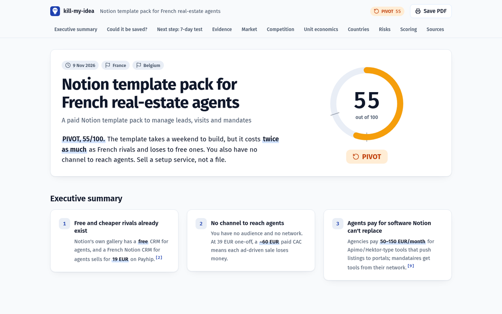
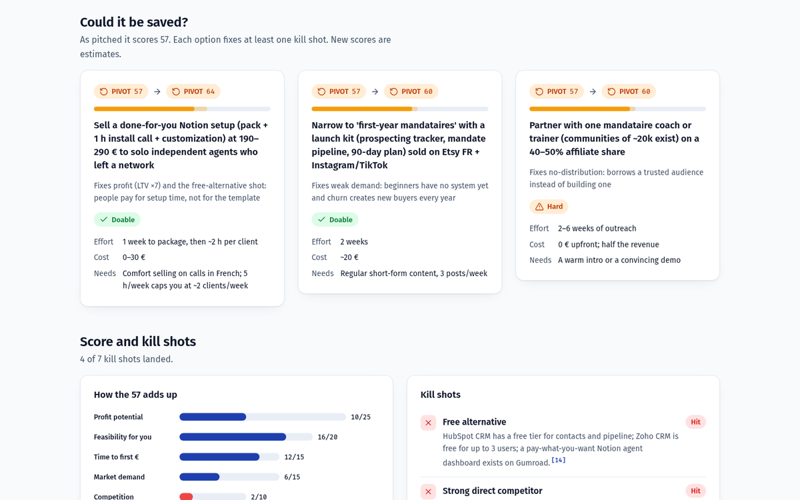

<div align="center">


```text
/plugin marketplace add RemiPelloux/kill-my-idea
/plugin install kill-my-idea@kill-my-idea
```

[Live reports](https://remipelloux.github.io/kill-my-idea/) &nbsp;·&nbsp; [Examples](examples/) &nbsp;·&nbsp; [Changelog](CHANGELOG.md) &nbsp;·&nbsp; [Sponsor](https://github.com/sponsors/RemiPelloux)

[](LICENSE)
[](https://github.com/RemiPelloux/kill-my-idea/stargazers)

</div>

Ask an AI whether your idea is good and it will usually find a way to say yes. kill-my-idea does
the opposite. It looks for a free alternative, competitors, people who already failed, and the
numbers that don't add up. Then it gives you a score out of 100, a GO / PIVOT / NO-GO verdict, the
ways the idea could still be saved, and a report where every number has a source.

## Paste a "$10k/month" tweet

The most common use: you see a viral thread promising easy money. Paste it in:

```text
kill my idea: <paste the thread>
```

It checks every claim, names what the author is selling, redoes the math and gives a verdict.
Real example, a viral thread about AI-written Amazon KDP books:

| The thread said | The check found |
|---|---|
| "$3,000 a month from 5 sales a day" | **About $1,380** in royalties once printing costs are counted ([KDP royalty rules](https://kdp.amazon.com/en_US/help/topic/G201834330)) |
| "Anyone can do it" | About 300k new books a month compete for the same shelf ([AI Policy Desk](https://www.aipolicydesk.com/blog/amazon-kdp-ai-generated-content-surge-enforcement-2026)) |
| "$3M from books" | No evidence ever shown. The author **sells KDP coaching** |
| Verdict | **PIVOT, 52/100.** Run a 1-week niche test before writing a word ([full card](examples/kdp-books.md)) |

## Same idea, two answers

We asked plain Claude and kill-my-idea about the same idea: an AI app that writes wedding speeches, at $19 each.

| | Claude, no plugin | kill-my-idea |
|---|---|---|
| Verdict | "It's a decent small business." | **NO-GO, 48/100** |
| Sources | None | 18, linked |
| Competition | "Several AI speech tools exist." | 14 named, priced $0–34. One live competitor made **$32.75 in 30 days** |
| Unit economics | "Margins are almost entirely marketing." | LTV $18 vs CAC $35 on paid search (estimates, reasoning shown). Every sale loses money |
| What to do next | Spend about $200 on ads and see | Don't build the app. List a human-polished speech on Fiverr at $49–99. Fewer than 3 paid orders in 7 days: archive it |

Plain Claude's full answer is [here, unedited](examples/plain-claude-wedding.md). The kill-my-idea version is a [live report](https://remipelloux.github.io/kill-my-idea/reports/wedding-speeches/).

## Seven ideas it has checked

<a href="https://remipelloux.github.io/kill-my-idea/"></a>

All seven are real runs, mostly ideas we were about to spend time or money on. The coloring book is
why this exists: we built it first, three versions and a day of work, and a five-minute search then
found the same book for free. The plugin also checked itself: 63, because fifteen open-source idea
validators already exist.

## The report

Every run writes `report.html`, a report you open in a browser and can print as an A4 PDF.

<a href="https://remipelloux.github.io/kill-my-idea/reports/notion-real-estate/"></a>

It opens with the answer, then shows what would change it:

<a href="https://remipelloux.github.io/kill-my-idea/reports/notion-real-estate/#rescue"></a>

It goes on to cover:
- the score breakdown;
- each kill shot, with its evidence;
- market size;
- a map of competitors by price and traction;
- a country comparison;
- LTV:CAC against healthy thresholds;
- monthly scenarios and a risk matrix;
- a 7-day test with the conditions for stopping it;
- numbered sources.

Every number shows whether it was sourced, estimated (hover for the reasoning) or not found.
One click on **Share card** downloads a PNG verdict card for social media, and reports follow your language (English or French).

## Commands

| Command | What it does |
|---|---|
| `/kill-my-idea:kill` | The verdict, report and 7-day test. Accepts one line, a pasted tweet, a URL or a long document |
| `/kill-my-idea:deepdive` | Six research tracks in parallel: market size, competitor teardown, real customer quotes, pricing, channels, regulation per country |
| `/kill-my-idea:check-tweet` | Fact-checks a viral "make money" post: every claim, the real math, what the author sells, then a verdict |
| `/kill-my-idea:roast` | The same verdict as five sourced one-liners, sized for a screenshot ([Juicero](examples/juicero-roast.md)) |
| `/kill-my-idea:compare` | Ranks every idea you've checked and picks the one to work on this week |

You can also just write "kill my idea: …", "is this worth building?" or "which idea should I do?".

<details>
<summary><strong>How the score works</strong></summary>

<br>

1. **Extract.** It turns your input into a brief: problem, customer, solution, price, channel, countries, claims.
2. **Ask once.** At most four questions (country, budget and time, goal, your edge), and only the ones that would change the verdict. Say "just go" to skip them.
3. **Look for kill shots**, searching in the target country's language:
   - a free alternative;
   - direct competitors;
   - people who already failed;
   - no way to reach customers;
   - costs that eat the margin;
   - weak demand;
   - legal or platform risk;
   - for "I make $10k a month" posts, what the author is selling;
   - a saturated wave of look-alike launches in the last 6–12 months.
4. **Measure:**
   - market size (TAM / SAM / SOM);
   - competitor prices and demand trend;
   - gross margin, CAC, LTV and LTV:CAC;
   - payback, break-even and time to first euro.
5. **Score.** Seven weighted criteria:

   | Criterion | Weight |
   |---|---|
   | Profit | 25 |
   | Feasibility for you | 20 |
   | Time to first € | 15 |
   | Demand | 15 |
   | Competition | 10 |
   | Risk | 10 |
   | Fit | 5 |

   GO at 70 and above, PIVOT from 50 to 69, NO-GO below 50. Three fixed rules stop it from rescuing a bad idea:
   - a free equivalent with no edge sets Competition to 1;
   - no channel rules out GO;
   - an LTV:CAC below 1 caps Profit.
6. **Rescue.** Up to three changes that would fix the kill shots, each re-scored and rated doable, hard or very hard.
7. **Test.** The cheapest way to get real proof in seven days, with numbers that tell you to stop.

The whole method is one readable file, [`skills/kill/SKILL.md`](skills/kill/SKILL.md). Fork it and change the weights.

</details>

<details>
<summary><strong>Files it writes</strong></summary>

<br>

Everything goes into `ideas/<YYYY-MM>-<slug>/` in your current folder.

| File | Contents |
|---|---|
| `report.html` + `report-data.js` | The designed report. Works offline and prints to PDF |
| `report.md` | The same report as plain text |
| `idea.json` | The extracted brief ([schema](skills/kill/idea.schema.json)) |
| `verdict.json` | Score, criteria, metrics with their sources, countries, rescue paths ([schema](skills/kill/verdict.schema.json)) |

</details>

<details>
<summary><strong>Questions</strong></summary>

<br>

**Isn't this just a prompt?**
It's a method with fixed rules, required sources, a schema for every output, and tests run on real
ideas. You can read all of it. The comparison above shows the difference in practice.

**Does it cost anything?**
No. It's MIT-licensed and runs on your own Claude Code plan. It never publishes anything, spends
money or contacts anyone for you.

**Can I share my verdict?**
Yes. Paste the badge it gives you into your README, or post the card in the
[verdict gallery](https://github.com/RemiPelloux/kill-my-idea/issues/new?template=share-verdict.yml).

**Does it work outside Claude Code?**
The skills follow the open [Agent Skills](https://agentskills.io) format. The `/plugin` install is Claude Code only.

</details>

## Support

If it saved you a weekend, a star helps other people find it. Sponsoring on
[GitHub Sponsors](https://github.com/sponsors/RemiPelloux) pays for new kill shots, country guides and better reports.

Contributions are welcome, see [CONTRIBUTING.md](CONTRIBUTING.md).

## License

The code is [MIT](LICENSE). The name "kill-my-idea" and the logo are trademarks of Remi Pelloux, not covered by the MIT License; see [TRADEMARK.md](TRADEMARK.md).
