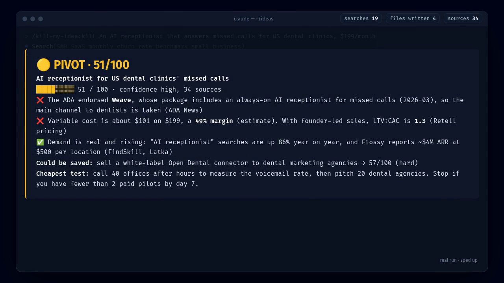
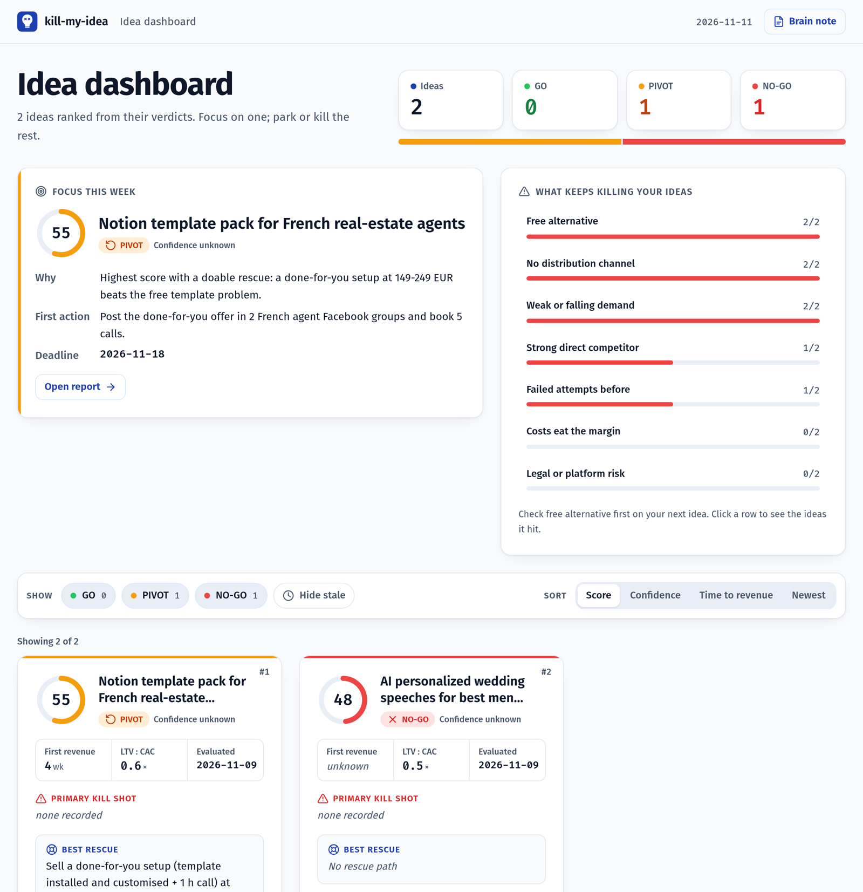

<div align="center">


```text
/plugin marketplace add RemiPelloux/kill-my-idea
/plugin install kill-my-idea@kill-my-idea
```

<a href="https://remipelloux.github.io/kill-my-idea/demo.mp4"></a>

<sub>▶ <a href="https://remipelloux.github.io/kill-my-idea/demo.mp4">Watch a real run (50 s)</a>: 19 searches, 34 sources, the verdict, the report and the dashboard.</sub>

[Live reports](https://remipelloux.github.io/kill-my-idea/) &nbsp;·&nbsp; [Gallery](https://remipelloux.github.io/kill-my-idea/gallery/board.html) &nbsp;·&nbsp; [Examples](examples/README.md) &nbsp;·&nbsp; [Security](SECURITY.md) &nbsp;·&nbsp; [Changelog](CHANGELOG.md) &nbsp;·&nbsp; [Roadmap](ROADMAP.md) &nbsp;·&nbsp; [Sponsor](https://github.com/sponsors/RemiPelloux)

[](LICENSE)
[](https://github.com/RemiPelloux/kill-my-idea/stargazers)
[](https://github.com/hashgraph-online/awesome-ai-plugins)
[](https://github.com/RemiPelloux/kill-my-idea/actions/workflows/hol-plugin-scanner.yml)

</div>

Ask an AI whether your idea is good and it will usually find a way to say yes. kill-my-idea does
the opposite. It looks for a free alternative, competitors, people who already failed, and the
numbers that don't add up. Then it gives you a score out of 100, a GO / PIVOT / NO-GO verdict, the
ways the idea could still be saved, and a report where every number has a source.

## Paste a "$10k/month" tweet

The most common use: you see a viral thread promising easy money. Paste it in:

```text
kill my idea: <paste the thread>
```

It checks every claim, names what the author is selling, redoes the math and gives a verdict.
Real example, a viral thread about AI-written Amazon KDP books:

| The thread said | The check found |
|---|---|
| "$3,000 a month from 5 sales a day" | **About $1,380** in royalties once printing costs are counted ([KDP royalty rules](https://kdp.amazon.com/en_US/help/topic/G201834330)) |
| "Anyone can do it" | About 300k new books a month compete for the same shelf ([AI Policy Desk](https://www.aipolicydesk.com/blog/amazon-kdp-ai-generated-content-surge-enforcement-2026)) |
| "$3M from books" | No evidence ever shown. The author **sells KDP coaching** |
| Verdict | **PIVOT, 52/100.** Run a 1-week niche test before writing a word ([full card](examples/kdp-books.md)) |

## Same idea, two answers

We asked plain Claude and kill-my-idea about the same idea: an AI app that writes wedding speeches, at $19 each.

| | Claude, no plugin | kill-my-idea |
|---|---|---|
| Verdict | "It's a decent small business." | **NO-GO, 44/100**, confidence high |
| Sources | None | 40, linked |
| Competition | "Several AI speech tools exist." | 11 named: AI tools at $0.99–65 a speech, human writers at $100–655, and free ChatGPT does the job. A look-alike app made **$9.98 in the last 30 days** ($311 all-time, Stripe-verified) |
| Unit economics | "Margins are almost entirely marketing." | LTV $19.7 vs CAC ~$35 on paid search: LTV:CAC 0.56 (estimates, reasoning shown). Every paid sale loses money |
| What to do next | Spend about $200 on ads and see | Archive the $19 app. If you want one test: a 7-day Fiverr gig for a $59 human-edited speech. Fewer than 3 inquiries: stop |

Plain Claude's full answer is [here, unedited](examples/plain-claude-wedding.md). The kill-my-idea version is a [live report](https://remipelloux.github.io/kill-my-idea/reports/wedding-speeches/).

## Seven ideas it has checked

<a href="https://remipelloux.github.io/kill-my-idea/"></a>

All seven are real runs, mostly ideas we were about to spend time or money on. The coloring book is
why this exists: we built it first, three versions and a day of work, and a five-minute search then
found the same book for free. The plugin also checked itself: 63, because fifteen open-source idea
validators already exist.

**[The gallery](https://remipelloux.github.io/kill-my-idea/gallery/board.html)** ranks 14 more real
runs on popular side hustles (dropshipping, Etsy planners, AI headshots, a faceless YouTube channel,
vending machines…), with every report one click away.

## The report

Every run writes `report.html`, a report you open in a browser and can print as an A4 PDF.

<a href="https://remipelloux.github.io/kill-my-idea/reports/notion-real-estate/"></a>

It opens with the answer, then shows what would change it:

<a href="https://remipelloux.github.io/kill-my-idea/reports/notion-real-estate/#rescue"></a>

It goes on to cover:
- the score breakdown: 21 sub-scores you can expand, the raw total, and which fixed rules capped it;
- a confidence level (high, medium or low) and the distance to the next verdict band;
- each kill shot, with its evidence, marked hit, clear or not checked, and the one that weighs most;
- market size;
- a map of competitors by price and traction;
- a country comparison;
- LTV:CAC against healthy thresholds;
- monthly scenarios and a risk matrix;
- a pre-mortem: the three most likely ways it dies, each with an early warning sign;
- **Why now?** (what changed that makes this the right time, or not) and the ideal first customer;
- a **What if?** card: move price, CAC, margin and lifetime with sliders and watch LTV, LTV:CAC, payback and the Profit sub-score update;
- a 7-day test with the conditions for stopping it;
- numbered sources, each tagged primary, secondary or tertiary.

Every number shows whether it was sourced, estimated (hover for the formula) or not found.
After a deep dive, the report shows how the score moved since the quick verdict.
One click on **Share card** downloads a PNG verdict card for social media, and reports follow your language (English or French).

## All your ideas in one place

Every run updates `ideas/board.html`, a dashboard of every idea you've checked, and
`ideas/BRAIN.md`, one note that remembers you and your ideas.



- **Focus this week:** the one idea `compare` picked, with why, a first action and a deadline.
- **What keeps killing your ideas:** how often each kill shot hit across all your ideas. Click a
  row to see which ideas it hit. Your next run checks your most frequent killer first.
- **Score history** on each card when an idea was re-checked (`deepdive`, `compare --refresh`).
- **The brain note** (`BRAIN.md`): your profile (country, budget, time, goal, edge), so the
  skill stops asking the same questions, then the ranking, your patterns and the lessons from
  killed ideas. Plain Markdown: it opens in Obsidian or any editor, and your own notes are kept.

Both are rebuilt from the verdicts by `scripts/build-brain.py`, so nothing on them is made up.

## Commands

| Command | What it does |
|---|---|
| `/kill-my-idea:kill` | The verdict, report and 7-day test. Accepts one line, a pasted tweet, a URL or a long document |
| `/kill-my-idea:deepdive` | Six research tracks in parallel, 40+ sources: market size, competitor teardown, real customer quotes, pricing, channels, regulation per country |
| `/kill-my-idea:check-tweet` | Fact-checks a viral "make money" post: every claim, the real math, what the author sells, then a verdict |
| `/kill-my-idea:roast` | The same verdict as five sourced one-liners, sized for a screenshot ([Juicero](examples/juicero-roast.md)). Also saved for `compare` |
| `/kill-my-idea:compare` | Ranks every idea you've checked by score, speed and confidence, picks the one to work on this week, and updates the dashboard and the brain note. `--refresh` re-checks the stale ones |
| `/kill-my-idea:build` | The starter kit for building an idea (or one of its rescue paths): README, `.env.example`, folder structure, PRD, architecture, user stories, sprints, Definition of Done, a 12-month business plan with 3 scenarios, brand tokens, a storyboard with a ready [Remotion](https://www.remotion.dev) video project, and creative ads with a target cost per customer ([example](examples/ugc-agency-build/BUILD.md)) |

You can also just write "kill my idea: …", "is this worth building?" or "which idea should I do?".

<details>
<summary><strong>How the score works</strong></summary>

<br>

1. **Extract.** It turns your input into a brief: problem, customer, solution, price, channel, countries, claims.
2. **Ask once.** At most four questions (country, budget and time, goal, your edge), and only the ones that would change the verdict. Say "just go" to skip them.
3. **Look for kill shots**, searching in the target country's language, with at least 20 sources
   from 10 domains, each tagged primary, secondary or tertiary:
   - a free alternative;
   - direct competitors;
   - people who already failed;
   - no way to reach customers;
   - costs that eat the margin;
   - weak demand;
   - legal or platform risk;
   - for "I make $10k a month" posts, what the author is selling;
   - a saturated wave of look-alike launches in the last 6–12 months.
4. **Measure:**
   - market size (TAM / SAM / SOM);
   - competitor prices and demand trend;
   - gross margin, CAC, LTV and LTV:CAC;
   - churn, conversion, payback, break-even and time to first revenue.
5. **Score.** Seven weighted criteria:

   | Criterion | Weight |
   |---|---|
   | Profit | 25 |
   | Feasibility for you | 20 |
   | Time to first revenue | 15 |
   | Demand | 15 |
   | Competition | 10 |
   | Risk | 10 |
   | Fit | 5 |

   Each criterion is the mean of three sub-scores (21 in all), each scored 1–5 against a fixed
   rubric with numeric anchors (a gross margin under 30% is a 1, over 85% a 5). The total is
   rounded half up, then six fixed rules stop it from rescuing a bad idea:
   - a free equivalent with no edge caps Competitive room at 1.5;
   - no channel caps the total at 69, so no GO;
   - a saturated wave of look-alike launches caps Competitive room and differentiation at 1.5;
   - an LTV:CAC below 1 caps Profit at 2;
   - every kill shot that hit must show in the sub-scores;
   - no channel **and** an LTV:CAC below 1 caps the total at 49: an idea that loses money on every
     customer and can't reach them is a NO-GO, however easy it is to build.

   GO at 70 and above, PIVOT from 50 to 69, NO-GO below 50. Every verdict carries a
   confidence level (high, medium or low) computed from how many sub-scores and sources back it.
6. **Rescue.** Up to three changes that would fix the kill shots, each re-scored and rated doable, hard or very hard.
7. **Test.** The cheapest way to get real proof in seven days, with numbers that tell you to stop.

The whole method is one readable file, [`skills/kill/SKILL.md`](skills/kill/SKILL.md). Fork it and change the weights.
After each run, `scripts/check-idea.py` recomputes the score, applies the rules and checks every source, so the
verdict you read is the one the sub-scores give.

</details>

<details>
<summary><strong>Files it writes</strong></summary>

<br>

Everything goes into `ideas/<YYYY-MM>-<slug>/` in your current folder.

| File | Contents |
|---|---|
| `report.html` + `report-data.json` | The designed report, one self-contained file built by `scripts/build-report.py` (the data is embedded as inert JSON, so the page runs no model-written code). Works offline and prints to PDF |
| `report.md` | The same report as plain text |
| `idea.json` | The extracted brief ([schema](skills/kill/idea.schema.json)) |
| `verdict.json` | Score, 21 sub-scores, rules applied, confidence, metrics with their sources, countries, rescue paths ([schema](skills/kill/verdict.schema.json)) |
| `deepdive.md` | The deep-dive write-up (`deepdive` only) |
| `roast.md` | The roast (`roast` only) |
| `ideas/board.html` + `ideas/BRAIN.md` | The dashboard and the brain note for all your ideas, rebuilt after every run |
| `ideas/RANKING.md` + `ideas/focus.json` | The ranking and this week's focus (`compare`) |
| `build/` | The starter kit (`build` only): start with `build/BUILD.md`. `build/plan.json` is the data ([schema](skills/build/build-plan.schema.json)); `scripts/build-kit.py` checks it against the verdict, does the business-plan math and renders the docs, `.env.example`, design tokens and the video props |

Check any run yourself:

```sh
python3 scripts/check-idea.py ideas/<folder>   # or --all for every idea
python3 scripts/build-brain.py ideas           # rebuild the dashboard and BRAIN.md by hand
python3 scripts/migrate.py --all ideas         # upgrade verdicts made before 1.0 to the 1.0 format
```

It recomputes the score from the sub-scores, applies the fixed rules, and checks every source and
count. `ERROR` lines mean the verdict doesn't follow its own rules.

To send a report to someone, bundle it into one file that opens anywhere, offline:

```sh
python3 scripts/export-standalone.py ideas/<folder>   # writes report-standalone.html
```

</details>

<details>
<summary><strong>Questions</strong></summary>

<br>

**Isn't this just a prompt?**
It's a method with a scoring rubric, fixed rules, source minimums, a schema for every output, a
checker that recomputes the score, and tests run on real ideas. You can read all of it. The comparison above shows the difference in practice.

**Does it cost anything?**
No. It's MIT-licensed and runs on your own Claude Code plan. It never publishes anything, spends
money or contacts anyone for you.

**Is it safe to install?**
It's listed in [Awesome AI Plugins](https://github.com/hashgraph-online/awesome-ai-plugins) and the
[HOL Registry](https://hol.org/registry/plugins) after their security review. Every push runs the
[HOL plugin scanner](.github/workflows/hol-plugin-scanner.yml) (100/100, no findings) and a
[template safety scan](scripts/scan-report.py). All GitHub Actions are pinned to commit SHAs. See [SECURITY.md](SECURITY.md).

**Can I share my verdict?**
Yes. Paste the badge it gives you into your README, or post the card in the
[verdict gallery](https://github.com/RemiPelloux/kill-my-idea/issues/new?template=share-verdict.yml).

**Will my old verdicts still work after an update?**
Yes. From 1.0 on, every file says which format wrote it (`schema_version`), and every 1.x release
reads every 1.x file. A change that breaks that needs a new major version (2.0). Verdicts from
before 1.0 upgrade with `python3 scripts/migrate.py --all ideas`. Ones made under older scoring
rules are listed as "re-run needed" rather than silently rescored. How the score is computed:
[docs/scoring.md](docs/scoring.md).

**Does it work outside Claude Code?**
The skills follow the open [Agent Skills](https://agentskills.io) format. The `/plugin` install is Claude Code only.

</details>

## Support

If it saved you a weekend, a star helps other people find it. Sponsoring on
[GitHub Sponsors](https://github.com/sponsors/RemiPelloux) pays for new kill shots, country guides and better reports.

Contributions are welcome, see [CONTRIBUTING.md](CONTRIBUTING.md).

## License

The code is [MIT](LICENSE). The name "kill-my-idea" and the logo are trademarks of Remi Pelloux, not covered by the MIT License; see [TRADEMARK.md](TRADEMARK.md).
