<div align="center">


# kill-my-idea

**Claude says your idea is great. This plugin tries to kill it — with sources.**

A brutally honest co-founder for [Claude Code](https://code.claude.com).
It validates startup and side-project ideas with real market research, gives them a score out of 100
and a **GO / PIVOT / NO-GO** verdict, before you waste a weekend or a budget.

[](LICENSE)
[](https://code.claude.com/docs/en/plugins/install)
[](CHANGELOG.md)
[](https://github.com/RemiPelloux/kill-my-idea/stargazers)



</div>

## Install

In Claude Code:

```text
/plugin marketplace add RemiPelloux/kill-my-idea
/plugin install kill-my-idea@kill-my-idea
```

Then just say it:

```text
kill my idea: an AI app that writes wedding speeches, sold at €19, France and US
```

Paste a tweet, a thread, a URL or a long doc instead and it extracts the idea for you.

## A report you'd pay a consultant for

Every verdict comes with **`report.html`**, a due-diligence dossier you open in your browser.
It works offline and prints to a clean A4 PDF.


What's inside:

| Section | What it shows |
|---|---|
| Cover | Answer-first summary, score gauge and verdict stamp |
| Could it be saved? | Each rescue path: the change, the projected score (e.g. NO-GO 48 → PIVOT 62), difficulty (doable / hard / very hard), effort, cost and what it needs |
| Score | The score broken down by criterion |
| Kill shots | Each kill-shot checked, with its evidence |
| Fact-check | The claims from the source, checked |
| Market | Market size: TAM, SAM and the share you can win (SOM) |
| Competitors | A map of competitors by price and traction |
| Countries | A side-by-side country comparison |
| Unit economics | LTV:CAC against healthy thresholds, and monthly scenarios |
| Risks | A matrix of likelihood against impact |
| 7-day test | The test plan and its kill criteria |
| Sources | Numbered footnotes |

Every number carries its evidence: ● sourced (with a footnote), ○ estimate (hover to see the reasoning), or *unknown*.

**See live reports:** [remipelloux.github.io/kill-my-idea](https://remipelloux.github.io/kill-my-idea/)

- [AI wedding speeches, France vs US: NO-GO 48](https://remipelloux.github.io/kill-my-idea/reports/wedding-speeches/)
- [Notion templates for French real-estate agents: PIVOT 57](https://remipelloux.github.io/kill-my-idea/reports/notion-real-estate/)

## What you get

| Command | What it does |
|---|---|
| `/kill-my-idea:kill` | **The verdict.** Extracts the idea, asks up to 4 sharp questions (country, budget, goal, edge), hunts for kill shots, computes the metrics, scores /100, writes a sourced report + a shareable card + the cheapest 7-day test |
| `/kill-my-idea:deepdive` | **Due diligence.** 6 parallel research tracks: market size, competitor teardown, customer voice (real quotes from reviews and Reddit), pricing ladder, channels with costs, regulation per country. 20+ sources, updated score |
| `/kill-my-idea:roast` | **The shareable one.** The same verdict as 5 savage burns, each backed by a sourced fact. Works on famous companies too |
| `/kill-my-idea:compare` | **Focus.** Ranks every idea you've evaluated and tells you which ONE to work on this week, which to pause and which to kill |

You don't have to remember the commands: "kill my idea", "rate my idea", "is this worth building?", "roast my startup" or "which idea should I do?" trigger them.

## Real verdicts, real money saved

These are not demos. They are ideas we actually considered.

> ## ☠️ NO-GO · 42/100
> **Printable cozy Christmas advent coloring book**
>
> `████░░░░░░` 42 / 100
>
> - ❌ A free 24-page advent coloring book makes the same promise for $0 ([source](https://lovelyplanner.com/?p=13510))
> - ❌ The Etsy niche is crowded at $2–16 a listing, with no channel of our own ([source](https://www.etsy.com/market/advent_coloring_book))
> - ✅ Real seasonal demand
>
> <sub>Killed by kill-my-idea</sub>

We built this one **before** checking: 3 versions, ~$1.50 of AI images, a full day of work.
A 5-minute competitor check killed it. That's why this plugin exists. → [full story](examples/coloring-book.md)

| Idea | Verdict | Killer fact |
|---|---|---|
| [AI-written KDP paperbacks](examples/kdp-books.md) (from a viral X thread) |  | The "$3k/month" turns into ~$1,380 once printing costs are counted, and the author sells coaching |
| [Bilingual travel affiliate blog](examples/travel-affiliate.md) |  | ~$0.03 earned per affiliate click; median travel blog −74% organic traffic |
| [AI wedding-speech app, France vs US](examples/wedding-speeches.md) (country mode) |  | 14+ tools already sell it for $0–34 and ChatGPT does it free; one live competitor made $32.75 in 30 days |
| [Juicero, roasted](examples/juicero-roast.md) (`/kill-my-idea:roast`) |  | Hands squeezed the packs faster than the $400 machine |
| [**This plugin**](examples/kill-my-idea.md) |  | 15+ open-source idea validators exist, so it pivoted to being the brutal one |

## How it works

1. **Extract**: any input becomes a structured idea brief: problem, customer, solution, revenue model, price, channel, countries, claims.
2. **Ask once**: at most 4 questions, only about what would change the verdict. Say "just go" to skip them.
3. **Hunt kill shots**, searching in parallel and in the target country's language:

   | # | Kill shot |
   |---|---|
   | 1 | Free alternative |
   | 2 | Direct competitors |
   | 3 | Graveyard of failed attempts |
   | 4 | No distribution channel |
   | 5 | Costs that eat the margin |
   | 6 | Weak demand |
   | 7 | Legal and platform risk |
   | 8 | The author's incentive (for "I make $10k/month" posts) |

4. **Measure** TAM/SAM/SOM, competitor price range, demand trend, gross margin, CAC, LTV, LTV:CAC, payback, break-even and time to first €. Each one is sourced, marked *estimate* with its reasoning, or left *unknown*.
5. **Score** 7 weighted criteria:

   | Criterion | Weight |
   |---|---|
   | Profit | 25 |
   | Feasibility for *you* | 20 |
   | Time to first € | 15 |
   | Demand | 15 |
   | Competition | 10 |
   | Risk | 10 |
   | Fit | 5 |

   GO ≥ 70 · PIVOT 50–69 · NO-GO < 50. Hard rules apply:
   - a free equivalent with no edge means Competition = 1;
   - no channel means it can never be GO;
   - LTV:CAC below 1 caps Profit.
6. **Rescue**: if it's a NO-GO or a PIVOT, find up to 3 ways to save it, each with a projected score, a difficulty (doable / hard / very hard), effort and cost.
7. **Plan** the smallest test that brings real proof in ≤ 7 days, with numeric kill criteria.

**Country-aware:** give it several countries and it compares local competitors, prices in local currency, laws, payment habits and channels, then recommends where to launch first.

## Files it writes

Everything goes into your project under `ideas/<YYYY-MM>-<slug>/`:

| File | What |
|---|---|
| `report.html` + `report-data.js` | The designed report: open it in a browser, print it to PDF |
| `report.md` | The same report as text: card, fact-check, kill shots, market, metrics, rescue paths, scenarios, risks, scorecard, test, sources |
| `idea.json` | The extracted brief ([schema](skills/kill/idea.schema.json)) |
| `verdict.json` | Score, criteria, metrics with their source or reasoning, country breakdown, rescue paths ([schema](skills/kill/verdict.schema.json)) |
| `deepdive.md` · `roast.md` | When you run those modes |

The JSON files make your ideas comparable over time, and easy to feed into your own scripts or dashboards.

## Show your verdict

Paste the badge into your project's README:

```markdown

```

Got roasted? Post the card with **#killmyidea**, or [share it in the gallery](https://github.com/RemiPelloux/kill-my-idea/issues/new?template=share-verdict.yml).

## FAQ

**Why not just ask Claude "is my idea good"?**
Because it will usually say yes. This plugin flips the default: Claude has to *find evidence to kill the idea*, every number needs a source or an *estimate* label, and fixed hard rules stop it from rescuing a bad idea with enthusiasm.

**Does it cost anything?**
No. It's MIT-licensed and runs on your own Claude Code plan. It never spends money, publishes anything or contacts anyone for you.

**Can I change the scoring?**
Yes. The whole method is one readable file: [`skills/kill/SKILL.md`](skills/kill/SKILL.md). Fork it and change the weights.

**Does it work outside Claude Code?**
The skills follow the open [Agent Skills](https://agentskills.io) format, so you can use them in other agents. The `/plugin` install is Claude Code only.

## Contributing

Ideas for new kill shots, country guides or better metrics are very welcome. See [CONTRIBUTING.md](CONTRIBUTING.md).

## License

[MIT](LICENSE) © Remi Pelloux
