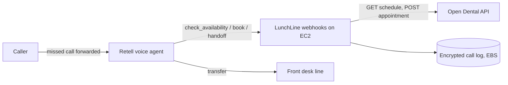

# Architecture

## Stack
**Node.js 22 (stdlib `node:http`) + Retell AI + Open Dental API, on AWS EC2 under the AWS BAA.**
Retell runs telephony, speech and the LLM, and calls our webhooks as custom functions. The Node service has 3 endpoints. A framework would add dependencies without adding value.

### Alternatives
- **Vapi + Twilio.** Vapi's HIPAA add-on is reported at $1,000-2,000/month, and Twilio's BAA needs Security Edition. That breaks the $2,000 budget.
- **NexHealth Synchronizer.** It reaches about 70 PMS, but BAAs sit on the custom Scale tier. Start Open Dental-only.

## Components

## Data model
- `clinic`: id, name, Open Dental customer key (an env/secret reference), forwarding number, hours, provider ids.
- `call`: id, clinic_id, started_at, outcome (booked | handoff | callback | abandoned), minutes.
- `booking`: id, call_id, Open Dental appointment number, slot start, status.
Store only the patient data needed to book. Keep it encrypted at rest and never put it in logs.

## External services (monthly, per the plan)
| Service | Cost / month | Source |
|---|---|---|
| Retell AI (~450 min x ~$0.12) | ~$54 per clinic | https://www.retellai.com/pricing?utm_category=ai |
| Open Dental API write tier | ~$32 per clinic | https://www.opendental.com/site/apipermissions.html |
| AWS EC2 + encrypted EBS, AWS BAA | ~$20 (estimate) | https://aws.amazon.com/compliance/hipaa-compliance |
| Stripe | card fees only | |

AWS Lightsail is not on AWS's HIPAA-eligible list, so use EC2.

## How `app/` is organised
- `src/slots.js` holds pure functions with no I/O, and is where most tests live.
- `src/openDental.js` is the only file that talks to Open Dental.
- `src/server.js` handles HTTP routing and webhook validation only.
- `src/config.js` holds env vars and named constants.
