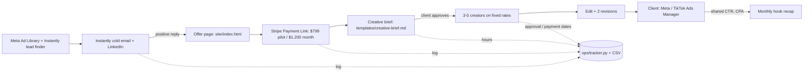

# Architecture: Hookline Studio

This is a service business. The "system" is a sales pipeline, a production process and a small tracker that tells the founder whether the numbers hold.

## Stack choice

**Static one-page offer + Stripe Payment Links + Instantly cold email + a Python stdlib ops tracker (CSV).**

Why: the only things to build are an offer page, a way to get paid and a way to measure hours per video against the kill criteria. Static HTML hosts for free, Stripe has no monthly fee, the tracker needs no install, and the whole stack fits the verdict's $86/month tool budget and 15 hours a week.

## Alternatives considered

| Alternative | Why not |
|---|---|
| Self-serve UGC platform as the back office (Insense, JoinBrands) | Insense starts near $400/month and JoinBrands charges 8-15% per order: that eats the margin, and the brand can see the same platform and go direct. |
| No-code client portal (Airtable or Notion with forms) | Useful at 5+ clients; for 1-2 pilot clients it is time the verdict says goes to sales. A CSV tracker answers the only question that matters now: hours per video. |

## Components

## Data model (CSV files in `TRACKER_DATA_DIR`, default `app/ops/data/`)

| File | Columns | Used for |
|---|---|---|
| outreach.csv | date, channel (email, linkedin), sent, positive | Day-7 rule: 3+ positive replies per 100 emails |
| orders.csv | order_id, client, kind (pilot, package), price, videos, creator_cost | Paid pilots (key metric), margin per order |
| hours.csv | date, order_id, hours, note | Hours per video (max 2), USD per hour (floor `HOURLY_FLOOR_USD`, default 20) |
| videos.csv | order_id, video, approved, paid | Creators paid within 7 days of approval |

Margin per order = price - creator cost - card fee (2.9% + $0.30, the verdict's assumption).

## External services and monthly cost

| Service | Tool | USD/month | Source |
|---|---|---|---|
| Cold email sending | Instantly Growth | 47 | https://instantly.ai/pricing.md |
| Lead finder | Instantly lead finder | 9 | https://instantly.ai/pricing.md |
| Sending domains and inboxes | 2 secondary domains + 3 Google Workspace inboxes | 30 | https://www.emailvendorselection.com/google-workspace-pricing/ |
| Payments | Stripe Payment Links | 0 (2.9% + 30c per charge) | |
| Offer page hosting | Any free static host | 0 | |
| Ops tracker | Python 3 standard library | 0 | |
| **Total** | | **86** | matches the verdict's fixed costs |

## How `app/` is organised

- `site/`: the offer page. Plain HTML and CSS, colours from `design-tokens.css`. The two buttons get the Stripe Payment Link URLs pasted in by the founder.
- `templates/`: the documents every order uses (cold email, brief, creator and client agreements). They are processes in text form; copy one per order.
- `ops/tracker.py`: the only code. Pure functions (`card_fee`, `outreach_status`, `order_metrics`, `pay_delay_days`) plus a CLI that appends to CSV and prints the report.
- `tests/`: `unittest` tests for the tracker's math and kill flags.
